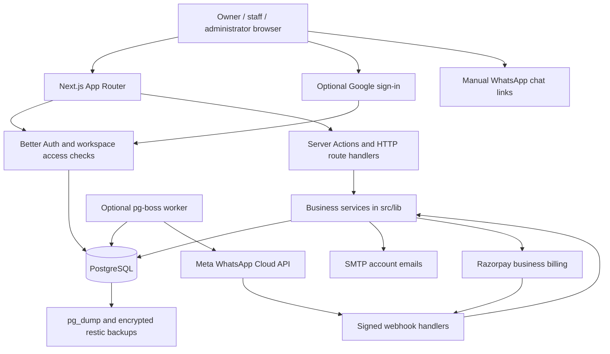

# membrr — Application Overview

**Documentation date:** 5 October 2026  
**Package:** `membrr-memberships` · **Application version:** `0.1.0` · **Private package**

This document describes the application in this workspace: its structure, technology, dependencies, features, data model, configuration, deployment, and operations. It is based on the source code, dependency lockfile, Prisma schema, deployment scripts, and existing project documentation. Production status below comes from the dated verification records; production was not queried while preparing this document. No environment secret values are included.

## Contents

1. [Product and scope](#1-product-and-scope)
2. [Architecture and framework](#2-architecture-and-framework)
3. [Project structure](#3-project-structure)
4. [Dependencies](#4-dependencies)
5. [Application features](#5-application-features)
6. [Roles and permissions](#6-roles-and-permissions)
7. [Database structure](#7-database-structure)
8. [Pages and HTTP endpoints](#8-pages-and-http-endpoints)
9. [Environment configuration](#9-environment-configuration)
10. [Local setup and commands](#10-local-setup-and-commands)
11. [Build and deployment](#11-build-and-deployment)
12. [Backups, recovery, and monitoring](#12-backups-recovery-and-monitoring)
13. [Security and data integrity](#13-security-and-data-integrity)
14. [Testing and verification](#14-testing-and-verification)
15. [Current limits and reference documents](#15-current-limits-and-reference-documents)

## 1. Product and scope

membrr is a membership management web application for Indian gyms and sports arenas. Each business has an isolated workspace for members, membership plans, payments, attendance, communication, and reporting. The application supports multiple businesses, with **one branch per business** enforced by the database.

The main users are business owners, staff, and platform administrators. Members do not have self-service accounts. Reception staff manage attendance and payments; owners control business settings and financial corrections; platform administrators manage businesses and their platform fees.

Key defaults:

| Area                   | Current behavior                                                         |
| ---------------------- | ------------------------------------------------------------------------ |
| Currency               | Indian rupees, stored as integer paise                                   |
| Business dates         | Asia/Kolkata; membership and paid-through end dates are inclusive        |
| New workspace trial    | Exactly 72 hours                                                         |
| Default workspace fee  | ₹499 per calendar month; configurable by platform administrators         |
| WhatsApp               | Manual preparation and user-initiated sending; no worker required        |
| Online payments        | Razorpay for a business's membrr subscription                         |
| Member payments        | Staff record cash, UPI, or bank transfers in the ledger                  |
| File and image storage | PostgreSQL, including shared files, business logos, and member photos    |
| Document output        | PNG downloads and browser printing, including Save as PDF                |
| Recorded hosting       | Azure App Service; a separate Docker Compose deployment is also provided |

## 2. Architecture and framework

The application uses a single Next.js codebase for the browser interface and server-side application. An optional separate worker handles Meta Cloud API messaging. PostgreSQL holds application data and, when enabled, the durable messaging queue.



### Framework choices

| Layer                 | Implementation                                                                            |
| --------------------- | ----------------------------------------------------------------------------------------- |
| Application framework | Next.js 16.3.8, App Router, Node.js runtime                                               |
| UI                    | React 19.3.0 with Server Components and interactive Client Components                     |
| Language              | TypeScript 7.0.2, strict checking, ES2022 target                                          |
| Styling               | Tailwind CSS 4.3.3 through its PostCSS plugin, global CSS, local Geist fonts              |
| UI primitives         | Radix UI and local shadcn-style components; `new-york` style and CSS variables            |
| Authentication        | Better Auth with a Prisma adapter, password login, optional Google OAuth                  |
| Database access       | Prisma 7.10.0 with `@prisma/adapter-pg`; parameterized SQL for selected reports and locks |
| Validation            | Zod schemas plus business-specific checks                                                 |
| Background jobs       | pg-boss using PostgreSQL; enabled for cloud messaging only                                |
| Deployment output     | Next.js standalone Node.js server                                                         |

### Request and data flow

1. A page or endpoint resolves the signed-in user through Better Auth.
2. `src/lib/context.ts` derives business, branch, user, role, and support context. Feature access also depends on business status and trial/paid entitlement.
3. Pages load business-scoped data on the server. Client Components provide forms, dialogs, charts, QR scanning, checkout, and document export.
4. Most business mutations use `src/app/actions.ts`. QR operations have dedicated actions in `src/app/attendance-actions.ts`. Uploads, exports, signup, billing, and webhooks use HTTP route handlers.
5. Services validate input and access, write through Prisma transactions where needed, and record audit events. Mutations revalidate affected Next.js views.

There is no separate Express backend or standalone frontend repository. No Redux or other global state library is declared; UI state uses React, and directory/report filters use URL parameters. The application needs a Node.js server and a live database; static-only hosting does not support its current functionality.

### Important configuration

- `next.config.ts` sets `output: "standalone"`, keeps `pg`, `pg-boss`, and `nodemailer` external to the server bundle, and sets the Server Action body limit to 3 MB.
- Upload endpoints apply their own streamed limits; the Server Action limit is not the shared-file upload limit.
- `tsconfig.json` enables strict TypeScript and maps `@/*` to `src/*`.
- The root layout loads Geist weights 400, 500, and 600 and uses a light application theme with a deep-navy sidebar and blue gradient accents (tokens in `src/app/globals.css`). Member documents have separate print styles.
- Workspace rendering is dynamic. Authentication and access checks occur in server code rather than a project-level middleware/proxy file.
- `src/lib/db.ts` configures a PostgreSQL pool maximum of 10 for each Prisma client instance and reuses the client during development.
- Before changing Next.js code, follow [AGENTS.md](AGENTS.md) and consult the installed guides under `node_modules/next/dist/docs/` for this version.

## 3. Project structure

```text
Membership Management/
├── src/
│   ├── app/
│   │   ├── (workspace)/          Authenticated workspace layout and feature pages
│   │   │   ├── dashboard/
│   │   │   ├── members/          Directory, creation, import, individual profile
│   │   │   ├── plans/
│   │   │   ├── payments/
│   │   │   ├── attendance/
│   │   │   ├── reports/
│   │   │   ├── whatsapp/         Follow-ups and new announcements/campaigns
│   │   │   ├── settings/
│   │   │   └── billing/          Business subscription billing
│   │   ├── api/                 Auth, signup, billing, webhooks, uploads, exports, health
│   │   ├── admin/               Platform business administration
│   │   ├── login/, signup/, onboarding/
│   │   ├── invite/, forgot-password/, reset-password/
│   │   ├── access-pending/, suspended/, upgrade/
│   │   ├── bills/, receipts/, member-card/
│   │   ├── files/[token]/       Public downloads through expiring bearer links
│   │   ├── actions.ts           Shared business mutation dispatcher
│   │   ├── attendance-actions.ts
│   │   ├── layout.tsx           Root layout, font imports, metadata
│   │   ├── page.tsx             Public landing page (signed-in visitors see Go to dashboard)
│   │   └── globals.css
│   ├── components/
│   │   ├── ui/                  Button, badge, card, dialog, input primitives
│   │   └── *.tsx / *.css        Forms, shell, scanner, charts, documents, checkout
│   ├── lib/                     Authorization, domain rules, persistence, integrations
│   └── worker.ts                Optional cloud messaging process
├── prisma/
│   ├── schema.prisma            Thirty application models
│   └── migrations/              Twelve ordered SQL migration directories
├── public/
│   └── member-import-template.csv
├── scripts/                     Bootstrap, local DB, build helper, integration drills
├── tests/                       Vitest unit and focused regression tests
├── e2e/                         Playwright browser scenarios
├── ops/                         Caddy, backup/restore, monitoring, Azure packaging
├── docs/                        Feature guides and dated verification records
├── package.json / package-lock.json
├── next.config.ts / tsconfig.json / prisma.config.ts
├── postcss.config.mjs / components.json
├── playwright.config.ts / vitest.config.ts
├── Dockerfile / compose.yaml / .dockerignore
├── .env.example / .env.backup.example
├── AGENTS.md / CLAUDE.md         Repository guidance files
├── README.md
└── APPLICATION_OVERVIEW.md       This document
```

`(workspace)` is a route group: its parentheses organize shared layouts without appearing in browser URLs. For example, `src/app/(workspace)/members/page.tsx` serves `/members`.

Generated/local directories include `node_modules/`, `.next/`, `.local/`, `.superdesign/`, `artifacts/`, and `test-results/`. They hold installed packages, compiled output, local database/tooling, design work, deployment archives, and test evidence. They are not the application source. Environment files and these working outputs are excluded through the relevant ignore/packaging rules.

### Main server modules

| Files under `src/lib/`                                                | Responsibility                                                    |
| --------------------------------------------------------------------- | ----------------------------------------------------------------- |
| `auth.ts`, `auth-client.ts`, `context.ts`                             | Authentication and server-derived workspace authorization         |
| `signup.ts`, `workspace-access.ts`, `admin.ts`                        | Signup/onboarding, trials, invitations, business creation         |
| `db.ts`, `database-schema.ts`                                         | Prisma connection and required-table/column readiness checks      |
| `domain.ts`, `services.ts`, `membership-billing.ts`                   | Dates, money, validation, member/membership/payment operations    |
| `member-directory.ts`                                                 | Shared directory queries, filters, counts, sorting, pagination    |
| `reporting.ts`, `reports.ts`, `report-filters.ts`                     | Dashboard aggregates and full reports                             |
| `manual-whatsapp.ts`, `manual-message-utils.ts`, `whatsapp-mode.ts`   | Manual messaging and mode enforcement                             |
| `messaging.ts`, `whatsapp.ts`, `delivery-batch.ts`                    | Optional cloud templates, campaigns, scheduling, delivery         |
| `member-qr.ts`, `member-qr-format.ts`                                 | QR issuance, lookup, replacement, attendance validation           |
| `shared-files.ts`, `shared-file-utils.ts`, `shared-file-http.ts`      | Uploads, quotas, file links, revocation, HTTP boundaries          |
| `business-logo.ts`, `business-logo-utils.ts`, `business-logo-http.ts` | Logo processing, permissions, serving                             |
| `member-photo.ts`, `member-photo-utils.ts`                            | Private member photo processing and storage                       |
| `member-documents.ts`, `member-document-format.ts`                    | Bill/card records, document totals, membership status             |
| `business-billing.ts`, `razorpay.ts`, `billing-http.ts`               | Razorpay order creation, verification, settlement, request checks |
| `security.ts`, `mail.ts`, `utils.ts`                                  | Encryption/signatures, SMTP, shared UI utilities                  |

## 4. Dependencies

The tables list **all direct dependencies**, with resolved versions from `package-lock.json` at the documentation date. `package.json` currently declares these with caret ranges. Use `npm ci` to install the lockfile versions reproducibly. Transitive packages are recorded in the lockfile.

### Runtime dependencies

| Package                    | Locked version | Purpose                                                     |
| -------------------------- | -------------- | ----------------------------------------------------------- |
| `next`                     | 16.3.8         | App Router, server rendering, route handlers, build/runtime |
| `react`                    | 19.3.0         | UI components and state                                     |
| `react-dom`                | 19.3.0         | React DOM rendering                                         |
| `@prisma/client`           | 7.10.0         | Generated database client                                   |
| `@prisma/adapter-pg`       | 7.10.0         | Prisma PostgreSQL driver adapter                            |
| `pg`                       | 8.23.1         | PostgreSQL driver                                           |
| `pg-boss`                  | 12.35.1        | Durable PostgreSQL-backed messaging jobs                    |
| `better-auth`              | 1.7.7          | Sessions, password authentication, Google OAuth             |
| `zod`                      | 4.6.5          | Input and provider-response validation                      |
| `dotenv`                   | 18.0.5         | Environment loading in database/tooling code                |
| `nodemailer`               | 10.0.13        | SMTP email                                                  |
| `date-fns`                 | 4.4.0          | Calendar/date helpers                                       |
| `papaparse`                | 5.7.0          | CSV processing                                              |
| `file-type`                | 22.1.1         | File-signature detection                                    |
| `sharp`                    | 0.35.5         | Image validation, resize, normalization, WebP conversion    |
| `qrcode`                   | 1.5.4          | QR generation                                               |
| `jsqr`                     | 1.4.0          | QR decoding from camera/image pixels                        |
| `html-to-image`            | 1.11.13        | Document PNG export                                         |
| `recharts`                 | 3.10.1         | Dashboard charts                                            |
| `@fontsource/geist`        | 5.3.0          | Locally bundled Geist font files                            |
| `lucide-react`             | 1.50.0         | Interface icons                                             |
| `@radix-ui/react-dialog`   | 1.1.23         | Dialog primitives                                           |
| `@radix-ui/react-label`    | 2.1.15         | Form-label primitives                                       |
| `@radix-ui/react-select`   | 2.3.7          | Select primitives                                           |
| `@radix-ui/react-slot`     | 1.3.3          | Component composition                                       |
| `@radix-ui/react-tabs`     | 1.1.21         | Accessible profile tabs                                     |
| `class-variance-authority` | 0.7.1          | Component variants                                          |
| `clsx`                     | 2.1.1          | Conditional CSS class construction                          |
| `tailwind-merge`           | 3.7.0          | Tailwind class conflict handling                            |
| `server-only`              | 0.0.1          | Server-only module boundary marker                          |

### Development and build dependencies

| Package                | Locked version | Purpose                                                        |
| ---------------------- | -------------- | -------------------------------------------------------------- |
| `typescript`           | 7.0.2          | Type checking                                                  |
| `tsx`                  | 4.23.15        | Runs TypeScript operational/test scripts and the worker        |
| `prisma`               | 7.10.0         | Client generation and migration CLI                            |
| `tailwindcss`          | 4.3.3          | CSS compilation                                                |
| `@tailwindcss/postcss` | 4.3.3          | Tailwind PostCSS integration                                   |
| `prettier`             | 3.9.9          | Source/document formatting                                     |
| `vitest`               | 5.0.3          | Unit/regression test runner                                    |
| `@playwright/test`     | 1.63.0         | Browser verification                                           |
| `embedded-postgres`    | 18.4.0-beta.17 | Development-only local PostgreSQL                              |
| `pngjs`                | 7.0.0          | PNG test-fixture processing                                    |
| `@types/node`          | 26.6.4         | Node.js type definitions; the deployment runtime is Node.js 24 |
| `@types/react`         | 19.3.0         | React types                                                    |
| `@types/react-dom`     | 19.3.0         | React DOM types                                                |
| `@types/nodemailer`    | 8.0.2          | SMTP library types                                             |
| `@types/papaparse`     | 5.5.2          | CSV library types                                              |
| `@types/pg`            | 8.23.1         | PostgreSQL driver types                                        |
| `@types/pngjs`         | 6.0.5          | PNG library types                                              |
| `@types/qrcode`        | 1.5.6          | QR generator types                                             |

The manifest also overrides `deepmerge-ts` to `8.0.2` and `mysql2` to `3.24.5`. These are dependency-tree overrides; the application database is PostgreSQL.

### External infrastructure and integrations

- **Node.js 24 and npm:** documented development and deployment runtime.
- **PostgreSQL:** version 18 in Compose; local verification records use PostgreSQL 18.4.
- **SMTP provider:** required for real invitations and password-reset emails.
- **Google OAuth:** optional identity provider; both client credentials must be configured.
- **Razorpay:** Standard Checkout browser script plus server REST requests; no Razorpay npm SDK is declared.
- **WhatsApp:** ordinary chat links in manual mode; Meta Graph API in optional cloud mode.
- **Docker/Caddy:** Linux VPS deployment tooling, with Caddy 2 providing HTTPS.
- **restic and S3-compatible storage:** encrypted off-site database backups in the supplied backup workflow.
- **External health-monitor service:** receives success/failure pings and detects missed pings.

There is no Redis requirement or separate upload storage service in the current application. S3-compatible storage is used by the backup workflow, not by normal file uploads.

## 5. Application features

### 5.1 Accounts, onboarding, and workspace access

- Password signup at `/signup` atomically creates an account, business, main branch, and owner access through the custom signup endpoint.
- Google signup/sign-in appears when both Google credentials are configured. New verified Google users complete business name and city at `/onboarding`.
- Returning users retain their workspace/role. Verified matching identities can link Google to an existing account. Public signup never grants platform administrator privileges.
- New self-service accounts receive a 72-hour trial starting at account creation; Google onboarding cannot restart or extend that trial.
- Platform-created workspaces start their trial immediately. Older invitation-only workspaces can start their trial when the first invited owner creates an account. Migrated legacy workspaces retain their access.
- After trial/paid access ends, feature pages redirect to `/upgrade`, and services/API boundaries enforce the restriction. Owners can still access billing to renew.
- Owners invite staff or another owner and remove access through Settings. Invitations expire after seven days; password-reset links expire after one hour.
- Password login remains enabled alongside Google. Better Auth's raw password-signup route is disabled because workspace signup uses the application-specific flow.

### 5.2 Dashboard

The dashboard reads actual business data for collections, unpaid balances, active memberships, and upcoming renewals. It includes collection charts and operational summaries rather than static demo counters.

### 5.3 Member directory and profiles

- Create/edit member name, phone, optional email, and notes; member codes identify records within a business.
- All, Active, Expiring, Expired, and Unpaid directory tabs with counts.
- Search, plan and fee filters, pagination, and sorting by name, join date, or expiry.
- Profiles organize Memberships, Payments, Attendance, WhatsApp, and Notes into tabs.
- Owner-controlled archival retains historical records.
- Owners can preview/import CSV and export filtered member data. Import headers are `name,phone,email,notes`, with a limit of 2,000 rows and 2 MB.
- Imports validate rows and skip existing matching name/phone records. Shared family numbers use one business contact, preserving the number's existing opt-out.
- Private member photos can be added after member creation. Owners/staff can upload, replace, or remove photos; missing photos fall back to initials.

### 5.4 Plans, memberships, taxes, and discounts

- Owners manage plan name, calendar-month duration, membership fee, admission fee, tax rate, tax treatment, and active status.
- Each activation or renewal creates a separate membership term and associated charge, preserving history.
- Owners/staff review start, end, and due dates. Overlapping terms are rejected.
- A first membership can include an admission fee; renewals do not add it again, including after a cancelled first term.
- Fixed-amount or percentage discounts require a reason and apply to the membership/admission subtotal. Tax is added or extracted according to the plan's tax mode.
- The form previews the calculation; the server recalculates from the stored plan and rejects a changed total for review.
- Charges snapshot fees, discount, tax rate, and tax amount so later plan changes do not rewrite historical bills.
- A 100% discount creates a zero-value charge with no payment required.

Membership end dates are inclusive. For example, a one-month term starting 2 October ends 1 November. Month calculations clamp to an available calendar date and then subtract a day; the documented 31 January 2026 example ends 27 February. Early renewals start after the current term; expired renewals default to today. Recording a payment does not itself activate or renew a membership.

Cancelling a term stops membership access and relevant renewal reminders while retaining its unpaid charge.

### 5.5 Member billing and payment ledger

- Record full or partial payments against a charge using cash, UPI, or bank transfer, with an optional reference.
- Track net paid and outstanding amounts across receipts and reversals.
- Payment writes lock the affected charge and use request idempotency keys to prevent duplicate entries.
- Owners can reverse a recorded payment with a reason. A negative ledger entry preserves the original receipt.
- Owners can waive a charge after any net recorded payments have been reversed.

Member payment entries record money received outside membrr. A reversal or waiver is an accounting correction; it does not initiate a bank refund.

### 5.6 Bills, receipts, membership cards, and branding

- View a charge bill even before the first payment, and open an individual receipt from payment history.
- Open a membership card through the member's QR panel.
- Download bills, receipts, and cards as PNG images at double resolution, or print them using the browser, including Save as PDF.
- Bills use the saved charge breakdown and show paid/balance/waived states. Receipts identify the individual payment and any reversal.
- Membership cards choose the current term, then the nearest upcoming term, then historical terms, and label inactive states.
- Owners manage business name, city, phone, address, and logo. Logos appear in the workspace and documents.
- Logo/member-photo uploads accept supported images up to 2 MB, validate/decode content, remove metadata, and store normalized WebP in PostgreSQL. Logos fit within 1024 × 1024 pixels.

Bills and receipts are payment documents, **not GST tax invoices**. No separate server-side PDF generation service is present.

### 5.7 Attendance and member QR

- Owners/staff can manually check in a member or scan a member QR using a camera or saved image.
- Only active memberships qualify; archived, expired, upcoming, and cancelled memberships are rejected.
- Staff see the matched name and explicitly confirm attendance. A scan alone creates no check-in.
- Attendance is unique per member per Asia/Kolkata day, including concurrent manual/QR attempts.
- Check-in history records the staff user and source (`STAFF` or QR).
- QR cards contain an opaque random identifier, with a hash for lookup and an encrypted token for retrieval.
- Owners can replace a lost QR, immediately invalidating the old one. Renewals retain the existing QR.
- Saved QR image decoding accepts PNG/JPG/WebP up to 10 MB and runs locally in the browser without uploading the scan image.

Camera scanning needs HTTPS or same-device localhost and camera permission. The QR is used by authenticated reception staff; it is not a public self-check-in URL.

### 5.8 Manual WhatsApp

Manual mode is the default unless `WHATSAPP_MODE` is exactly `cloud`.

1. Select a member or follow-up for expiry or unpaid fees.
2. Prepare an editable message using current dates/balances and optional file links.
3. Open WhatsApp or copy the text; the user reviews and sends it from their own WhatsApp account.
4. Return to membrr and explicitly confirm sending before saving manual history.

Owners can prepare announcements by audience or selected members, with `{name}` and `{business}` placeholders. Recipients are handled one chat at a time. The limit is 2,000 characters after personalization and file-link expansion; audience pages contain 50 recipients and deduplicate shared numbers within each page.

Messaging is enabled by default for contacts. Existing opt-outs still block the shared phone number; historical consent columns remain but no longer determine eligibility. Current member forms do not require consent fields, and the member profile has no Stop WhatsApp control.

`ManualSend` history means a staff member confirmed sending. It is not provider delivery/read tracking. Regular WhatsApp does not send inbound replies back into this application.

### 5.9 Images and documents shared through links

- Upload JPG/JPEG, PNG, WebP, PDF, or DOCX, up to 10 MiB per file. Legacy `.doc` files are unsupported.
- Select up to three files per manual message.
- Reuse library links, which expire 30 days after upload and work for anyone holding the token.
- Owners manage all business links; staff manage their own uploads.
- Revocation disables the shared URL and removes current stored content while retaining audit metadata.
- Pilot quotas: 100 MiB, 50 active files per business, and 20 uploads per hour; concurrent quota checks are serialized.
- Expired links stop working immediately. Expired bytes are reclaimed on the next successful business upload.
- Suspended businesses' downloads are unavailable.

Content and metadata are stored in PostgreSQL and included in database backups. A public canonical HTTPS origin is required for member-facing links. Revocation cannot remove a file someone already downloaded or a copy still present in retained backups. File-signature checks are not malware scanning.

### 5.10 Reports

| Report             | Content and rules                                                                                            |
| ------------------ | ------------------------------------------------------------------------------------------------------------ |
| Member list        | Current member/contact/plan/status/expiry/balance; excludes archived members                                 |
| Collections        | Gross receipts, reversals, net amounts, and entry counts by day/week/month; includes zero-activity periods   |
| Dues & outstanding | Current unpaid charges with net paid, balance, and ageing buckets: current, 1–30, 31–60, 61–90, over 90 days |
| Renewals           | Terms expiring in the selected range, next booked terms, and renewal-needed filters                          |
| Attendance         | Visit counts by member, with first/last visit; retains visits after archival                                 |

Owners and staff can view reports; only owners export CSV. Date-based reports use inclusive IST ranges, Monday-start weeks, common presets, and custom ranges up to 366 days. Renewals default to the next 30 days. Tables show 25 rows per page; summary cards and exports cover the full filtered result.

Reversals affect collections on the reversal date. Archived members/cancelled terms retain debts; waived charges are excluded from dues. A charge due today is not overdue. Member and dues reports show the current position, not a historical snapshot. CSV export uses ISO dates, two-decimal INR amounts, and escaped text formula prefixes; successful exports are audited.

### 5.11 Business subscription billing

This is separate from the member payment ledger. Platform administrators configure each business's monthly fee. Owners use Razorpay Standard Checkout for a single calendar-month payment, with no automatic recurring mandate.

- The server creates orders using the saved fee and reuses a matching unpaid order where possible.
- Callback HMAC verification, provider payment lookup, and signed webhooks confirm the order, amount, currency, capture state, and refund state.
- Callback, status-recovery, and webhook paths settle under a business row lock so one payment credits one month once.
- Early renewal extends the existing paid-through period; lapsed renewal starts from confirmation day without charging arrears.
- Owners can recover a delayed/missed callback through Check payment status and view recent orders.
- Staff and support sessions cannot make subscription payments.
- A platform suspension remains in force after payment. Trial/paid expiry is an access restriction separate from administrative suspension.
- Refunds/disputes are handled in Razorpay; later refunds do not automatically shorten a period already credited.

Blanking a business fee disables new checkout creation. It does not itself grant access to a trial-expired workspace, cancel open provider orders, or change existing paid-through dates. Test payments also credit dates, so provider Test Mode checks belong in isolated staging data.

### 5.12 Platform administration

- Create a business from name and city; the creating administrator receives owner access immediately without an invitation.
- Open/switch among businesses owned by that administrator.
- Configure monthly business fees and suspend/reactivate businesses.
- Resend pending invitations and inspect platform operational information.
- Start support access with a recorded reason for 30 minutes, then explicitly end it or allow it to expire.
- Record support grants and identify support-driven mutations in audit history.

### 5.13 Optional Meta Cloud API messaging

The retained cloud integration is enabled only by `WHATSAPP_MODE=cloud` and a running worker. Manual mode blocks automatic sending and scheduling, including previously queued work.

- Connect and verify a business sender, sync approved text templates, map positional variables, preview/schedule campaigns, and cancel queued campaigns.
- Default renewal reminders: 7, 3, and 0 days before expiry. Default dues reminders: 1 and 7 days after due date. Default sending hour: 10 a.m. IST.
- A durable minute tick creates due work; each business has an exclusive delivery batch, bounded to 45 seconds, with up to 10 businesses processed concurrently.
- Immediately before sending, recheck business/member/access eligibility, opt-outs, phone, template, cancellation, renewals, and balances.
- Definitive rate limits use bounded backoff. Ambiguous/interrupted sends become `UNKNOWN` and are not blindly retried; signed callbacks may reconcile them.
- Inbound supported STOP-style keywords suppress future messages for that contact.
- `WHATSAPP_DRY_RUN=true` produces simulated outcomes; it does not report real delivery.

Cloud templates support text with positional body variables. Media templates, buttons, named variables, and a shared chat inbox are outside the current scope.

## 6. Roles and permissions

Permissions are enforced in server actions/services and route handlers, in addition to UI controls. The table assumes an active business and valid workspace entitlement where required.

| Capability                                             | Owner                | Staff       | Platform administrator                               |
| ------------------------------------------------------ | -------------------- | ----------- | ---------------------------------------------------- |
| View dashboard, directory, profiles, reports           | Yes                  | Yes         | Through owned workspace or authorized support access |
| Add/edit members and member photos                     | Yes                  | Yes         | Through workspace context                            |
| Activate/renew/cancel memberships; record payments     | Yes                  | Yes         | Through workspace context                            |
| Apply membership discount with a reason                | Yes                  | Yes         | Through workspace context                            |
| Archive members; import/export members; export reports | Yes                  | No          | Through owner context                                |
| Create/edit/deactivate plans                           | Yes                  | No          | Through owner context                                |
| Reverse payments or waive charges                      | Yes                  | No          | Through owner context                                |
| Record attendance; issue/retrieve member QR            | Yes                  | Yes         | Through workspace context                            |
| Replace a member QR                                    | Yes                  | No          | Through owner context                                |
| Individual manual WhatsApp follow-ups                  | Yes                  | Yes         | Through workspace context                            |
| Prepare announcements                                  | Yes                  | No          | Through owner context                                |
| Manage shared file links                               | All business uploads | Own uploads | According to workspace role                          |
| Manage business details/logo and staff access          | Yes                  | No          | Through owner context                                |
| Pay business subscription                              | Yes                  | No          | Only as an actual owner; blocked in support sessions |
| Create/suspend businesses and set platform fees        | No                   | No          | Yes                                                  |
| Grant temporary support access                         | No                   | No          | Yes, with recorded reason                            |

A platform administrator flag does not provide unscoped access to every business's feature pages. Workspace selection and support grants are checked server-side. Support context is temporary and audited; service operations also recheck its validity and workspace access.

## 7. Database structure

The schema uses PostgreSQL and currently defines **30 Prisma models**. Prisma reads `DATABASE_URL` through `prisma.config.ts`. Application models use business identifiers and selected composite foreign keys/unique constraints to preserve tenant relationships; authorization is enforced by application code, not a documented PostgreSQL row-level-security policy.

| Domain               | Models                                                         | Stored information                                                              |
| -------------------- | -------------------------------------------------------------- | ------------------------------------------------------------------------------- |
| Authentication       | `User`, `Session`, `Account`, `Verification`                   | Identities, password/provider accounts, sessions, verification/reset data       |
| Workspace            | `Business`, `Branch`, `StaffAccess`, `Invitation`              | Business settings/status/trial/billing dates, single branch, roles, invitations |
| Branding             | `BusinessLogo`                                                 | Business WebP image bytes and version                                           |
| Member directory     | `Contact`, `Member`, `MemberPhoto`                             | Shared phone/opt-out record, member identity/notes/archive state, photo bytes   |
| Membership billing   | `Plan`, `Membership`, `Charge`, `Payment`                      | Plan configuration, dated terms, charge snapshots, receipts/reversals           |
| Attendance           | `Checkin`, `MemberQr`                                          | Daily visits, recording source/user, QR token hash/encrypted value              |
| Manual communication | `ManualSend`, `SharedFile`                                     | Confirmed manual history and expiring linked-file content/metadata              |
| Cloud communication  | `WhatsAppConnection`, `MessageTemplate`, `Campaign`, `Message` | Sender credentials, templates, campaigns, message lifecycle                     |
| Platform billing     | `BusinessBillingOrder`                                         | Razorpay order/payment IDs, quoted amount, credited period                      |
| Audit/support        | `AuditLog`, `SupportGrant`                                     | Actor/action history and temporary support authorization                        |
| Operations           | `WorkerHeartbeat`, `WebhookEvent`, `RateLimit`                 | Health timestamps, webhook deduplication, request limits                        |

### Principal relationships and invariants

- A business owns its branch, access records, members, plans, finances, messages, and uploads.
- `Branch.businessId` is unique, enforcing one branch per business even though the schema exposes a branch collection.
- A user has one `StaffAccess` record per business, with OWNER or STAFF role.
- A business contact phone is unique within that business; multiple members may share it.
- A member has many historical membership terms and at most one current stored photo and QR record.
- Each membership has at most one associated charge; a charge can have several payments.
- Reversal entries use negative amounts and a unique `reversalOfId` to retain the original ledger record.
- `(businessId, memberId, day)` is unique for attendance.
- QR/share tokens and financial/manual-send request keys have uniqueness constraints for lookup and deduplication.
- Business billing orders are separate from member charges/payments.

### Migration history

| Directory                            | Purpose                                          |
| ------------------------------------ | ------------------------------------------------ |
| `20261002174000_init`                | Initial schema                                   |
| `20261002175958_relation_indexes`    | Relation indexes                                 |
| `202610030001_manual_whatsapp`       | Manual-send history                              |
| `202610030002_shared_files`          | Shared uploads and links                         |
| `202610030003_member_qr`             | Member QR and attendance source                  |
| `202610030004_member_qr_relation`    | QR/member relationship constraints               |
| `202610030005_business_billing`      | Razorpay business orders and billing fields      |
| `202610040001_signup_trial`          | Trial and workspace entitlement                  |
| `202610040002_business_logo`         | Stored business logos                            |
| `202610040003_member_billing`        | Admission fees, tax, discounts, charge snapshots |
| `202610040004_member_documents`      | Business contact information and member photos   |
| `202610040005_member_photo_relation` | Photo/member relationship constraints            |

Use `npm run db:migrate` (`prisma migrate deploy`) to apply committed migrations. A build generates the Prisma client but does **not** apply database migrations. Check every pending migration in the release bundle, including migrations belonging to earlier changes.

## 8. Pages and HTTP endpoints

### Browser pages

| URL                                   | Purpose/access                                                              |
| ------------------------------------- | --------------------------------------------------------------------------- |
| `/`                                   | Public landing page                                                         |
| `/login`                              | Password and optional Google sign-in                                        |
| `/signup`                             | Public owner/workspace signup and optional Google signup                    |
| `/onboarding`                         | Complete new verified Google user's workspace                               |
| `/invite/[token]`                     | Invitation acceptance and account setup                                     |
| `/forgot-password`, `/reset-password` | Password recovery                                                           |
| `/access-pending`                     | Signed-in user without workspace access                                     |
| `/suspended`                          | Suspended-business notice                                                   |
| `/upgrade`                            | Trial/paid-access expiry and renewal guidance                               |
| `/dashboard`                          | Workspace metrics                                                           |
| `/members`                            | Member directory                                                            |
| `/members/new`                        | Create member                                                               |
| `/members/import`                     | Owner CSV import                                                            |
| `/members/[id]`                       | Member profile and operational tabs                                         |
| `/plans`                              | Membership plans; owner editing                                             |
| `/payments`                           | Member payment ledger                                                       |
| `/attendance`                         | Daily attendance and QR scanner                                             |
| `/reports`                            | Member, collections, dues, renewals, attendance reports                     |
| `/whatsapp`                           | Manual follow-ups/history or cloud messaging view                           |
| `/whatsapp/new`                       | Owner announcement/campaign creation, depending on mode                     |
| `/settings`                           | Business details, logo, staff, and mode-dependent messaging settings        |
| `/billing`                            | Owner business subscription checkout/history; accessible after trial expiry |
| `/admin`                              | Platform administrator business management                                  |
| `/bills/[id]`                         | Authenticated charge bill; ID identifies the charge                         |
| `/receipts/[id]`                      | Authenticated payment receipt; ID identifies the payment                    |
| `/member-card/[id]`                   | Authenticated membership card; ID identifies the member                     |

### HTTP route handlers

| Method            | URL                        | Purpose                                                                        |
| ----------------- | -------------------------- | ------------------------------------------------------------------------------ |
| GET, POST         | `/api/auth/[...all]`       | Better Auth routes, including `/api/auth/callback/google`                      |
| POST              | `/api/signup`              | Validated, rate-limited password/workspace signup                              |
| GET               | `/api/health`              | Database/schema readiness and optional worker heartbeat                        |
| GET               | `/api/members/export`      | Owner filtered member CSV                                                      |
| GET               | `/api/reports/export`      | Owner filtered report CSV                                                      |
| GET, POST, DELETE | `/api/business/logo`       | Read/save/remove current business logo                                         |
| GET, POST, DELETE | `/api/members/[id]/photo`  | Read/save/remove private member photo                                          |
| GET, POST         | `/api/shared-files`        | List authorized uploads or upload a file                                       |
| DELETE            | `/api/shared-files/[id]`   | Revoke a shared file link                                                      |
| GET               | `/files/[token]`           | Public token-authorized download, subject to expiry/revocation/business checks |
| POST              | `/api/billing/orders`      | Create/reuse Razorpay business order                                           |
| POST              | `/api/billing/orders/[id]` | Check/reconcile a pending order's payment status                               |
| POST              | `/api/billing/verify`      | Verify browser checkout response                                               |
| POST              | `/api/webhooks/razorpay`   | Signed captured-payment/order webhook                                          |
| GET, POST         | `/api/webhooks/whatsapp`   | Meta verification challenge and signed event handling                          |

The APIs support the application interface and integrations; this repository does not define a general public member/customer API. Member creation, renewals, payment recording, and QR attendance primarily use Server Actions rather than separate REST CRUD endpoints.

## 9. Environment configuration

Use [.env.example](.env.example) and [.env.backup.example](.env.backup.example) as templates. Real values belong in local environment files or the hosting provider's secret/app settings. None of the listed secret variables should use a `NEXT_PUBLIC_` prefix.

### Core application and hosting

| Variable                    | Purpose                                                                                                     |
| --------------------------- | ----------------------------------------------------------------------------------------------------------- |
| `DATABASE_URL`              | PostgreSQL connection URI; Azure requires the assembled URI with TLS                                        |
| `BETTER_AUTH_URL`           | Canonical application origin for auth callbacks, invitations, origin validation, and shared links           |
| `BETTER_AUTH_SECRET`        | Random auth secret of at least 32 characters; also used by Better Auth for OAuth-token encryption           |
| `CREDENTIAL_ENCRYPTION_KEY` | Independent 32-byte key encoded as 64 hex characters, used for QR/share tokens and cloud sender credentials |
| `NODE_ENV`                  | `production` for deployed builds/runtime                                                                    |
| `HOSTNAME`, `PORT`          | Server bind address and port; Azure supplies its runtime port                                               |
| `APP_DOMAIN`                | Docker/Caddy hostname; Compose derives the public auth origin from it                                       |
| `POSTGRES_PASSWORD`         | Compose database password; a random hex password fits its connection-string interpolation                   |

### Email, authentication, and billing

| Variable                                   | Purpose                                                                                 |
| ------------------------------------------ | --------------------------------------------------------------------------------------- |
| `GOOGLE_CLIENT_ID`, `GOOGLE_CLIENT_SECRET` | Optional Google OAuth; both required to enable the button                               |
| `SMTP_HOST`, `SMTP_PORT`                   | SMTP server; port defaults to 587, and 465 selects implicit TLS                         |
| `SMTP_USER`, `SMTP_PASSWORD`               | SMTP credentials when required                                                          |
| `SMTP_FROM`                                | Sender identity for account/alert emails                                                |
| `ALLOW_LOCAL_EMAIL_LOG`                    | Development-only email logging when SMTP is absent; set `false` in production           |
| `RAZORPAY_KEY_ID`, `RAZORPAY_KEY_SECRET`   | Razorpay account/API credentials                                                        |
| `RAZORPAY_WEBHOOK_SECRET`                  | Independent secret for raw-body webhook verification; billing configuration requires it |

Google's authorized redirect URI is `<BETTER_AUTH_URL>/api/auth/callback/google`. Razorpay webhooks use `<BETTER_AUTH_URL>/api/webhooks/razorpay`; enable automatic capture and subscribe to `payment.captured` and `order.paid`.

### Messaging and monitoring

| Variable                    | Purpose                                                                   |
| --------------------------- | ------------------------------------------------------------------------- |
| `WHATSAPP_MODE`             | `manual` by default; only the exact value `cloud` enables cloud mode      |
| `WHATSAPP_DRY_RUN`          | Exact value `true` simulates cloud sends; keep enabled during cloud setup |
| `META_APP_SECRET`           | Verifies Meta webhook signatures                                          |
| `META_WEBHOOK_VERIFY_TOKEN` | Meta webhook verification challenge                                       |
| `META_GRAPH_VERSION`        | Defaults to `v25.0`                                                       |
| `ALERT_EMAIL`               | Optional cloud backlog alert recipient, sent over SMTP                    |
| `MONITOR_HEALTHCHECK_URL`   | External availability-monitor ping endpoint                               |

### Backup and operational variables

| Variable                                       | Purpose                                                                  |
| ---------------------------------------------- | ------------------------------------------------------------------------ |
| `RESTIC_REPOSITORY`                            | Off-site restic repository URL, normally S3-compatible                   |
| `RESTIC_PASSWORD`                              | Backup repository encryption password; save separately for recovery      |
| `AWS_ACCESS_KEY_ID`, `AWS_SECRET_ACCESS_KEY`   | Scoped S3-compatible backup credentials                                  |
| `BACKUP_HEALTHCHECK_URL`                       | External backup success/failure/missed-run monitoring                    |
| `RESTORE_DATABASE`                             | Explicit new database name for a restore drill                           |
| `PGHOST`, `PGUSER`, `PGDATABASE`, `PGPASSWORD` | PostgreSQL client settings passed to the backup container                |
| `ADMIN_EMAIL`, `ADMIN_PASSWORD`, `ADMIN_NAME`  | One-time administrator bootstrap inputs; password at least 16 characters |
| `SEED_DEMO`                                    | Enables local synthetic demo behavior; not a production setting          |
| `E2E_BASE_URL`                                 | Browser-test base URL, default `http://localhost:3000`                   |
| `PG_BIN`, `RESTIC_BINARY`                      | Local backup-drill binary overrides                                      |

## 10. Local setup and commands

### Development with the bundled database

Install Node.js 24 and npm. In the project root:

```sh
npm ci
npm run db:local
```

Keep the database process running. On first use, the script creates `.env` only if it is absent, generates random development secrets, binds PostgreSQL to `127.0.0.1:54329`, and keeps its data in `.local/postgres`. An existing `.env` must reference a loopback database for this runner.

In a second terminal:

```sh
npm run db:generate
npm run db:migrate
npm run db:seed
npm run dev
```

Open [http://localhost:3000](http://localhost:3000). The development server binds to `127.0.0.1`. Seeding is restricted to local synthetic data; use the demo-account information in [README.md](README.md). For a separately managed PostgreSQL server, configure `.env` from the template and skip `db:local`.

Manual WhatsApp requires no worker. For a local production build:

```sh
npm run build
npm start
```

Stop any existing app process using the same port before starting another. Keep the database running. The worker, if explicitly needed for cloud mode, runs separately with `npm run worker`.

### Main npm commands

| Command               | Action                                                                            |
| --------------------- | --------------------------------------------------------------------------------- |
| `npm run dev`         | `next dev --hostname 127.0.0.1`                                                   |
| `npm run build`       | Generate Prisma client, build Next.js, prepare standalone assets                  |
| `npm start`           | Run `.next/standalone/server.js`, loading `.env` if present                       |
| `npm run worker`      | Run `src/worker.ts` through `tsx`                                                 |
| `npm run typecheck`   | TypeScript `tsc --noEmit`                                                         |
| `npm run format`      | Prettier write across configured source/script/test/doc/config paths              |
| `npm run db:generate` | Prisma client generation                                                          |
| `npm run db:migrate`  | Apply committed migrations with `prisma migrate deploy`                           |
| `npm run db:seed`     | Local synthetic seed data                                                         |
| `npm run db:local`    | Persistent local embedded PostgreSQL process                                      |
| `npm run bootstrap`   | Create the initial platform administrator without overwriting an existing account |

There is no `lint` script or repository CI workflow in the inspected source. Test commands are listed in [Testing and verification](#14-testing-and-verification).

## 11. Build and deployment

### 11.1 Build contract

`npm run build` performs:

```text
prisma generate
    → next build
    → tsx scripts/prepare-standalone.ts
```

The final step copies `.next/static` and `public` into `.next/standalone`, alongside the generated server. Production startup is:

```sh
node --env-file-if-exists=.env .next/standalone/server.js
```

Build tools are in `devDependencies`, so install them in the build environment even when the runtime is production. `DATABASE_URL` must be defined for the Prisma configuration during generation. Database migrations are a separate release step.

### 11.2 Azure App Service — recorded production deployment

The existing deployment guide records a Linux Azure App Service named `pep` running Node.js 24 LTS, with an Azure PostgreSQL connection. The recorded app URL is:

[https://pep-b5f5axg9fjgucsg8.centralindia-01.azurewebsites.net](https://pep-b5f5axg9fjgucsg8.centralindia-01.azurewebsites.net)

The project uses a **source ZIP built on Azure's Linux host**. Regenerate it after application changes:

```powershell
pwsh -File ops/package-azure.ps1
```

Output: `artifacts/membrr-azure-source.zip`. Packaging allowlists the application source, public files, Prisma schema/migrations, build configuration, lockfile, and required standalone/bootstrap scripts. It excludes local dependencies, `.next`, `.env` files, and local database data. Do not reuse Windows-built `node_modules` or compiled output on Linux.

Required build/runtime settings:

| Azure setting                    | Value/requirement                                                                   |
| -------------------------------- | ----------------------------------------------------------------------------------- |
| Stack                            | Node.js 24 LTS on Linux                                                             |
| `SCM_DO_BUILD_DURING_DEPLOYMENT` | `true`                                                                              |
| `ENABLE_ORYX_BUILD`              | `true`                                                                              |
| `NPM_CONFIG_PRODUCTION`          | `false`, to install build dependencies                                              |
| `NODE_ENV`                       | `production`                                                                        |
| Startup command                  | `HOSTNAME=0.0.0.0 npm start`                                                        |
| Database                         | Nonblank `DATABASE_URL`, percent-encoded credentials, TLS such as `sslmode=require` |
| Origin                           | `BETTER_AUTH_URL` set to the deployed public HTTPS origin                           |
| Default messaging                | `WHATSAPP_MODE=manual`                                                              |
| Local email logging              | `ALLOW_LOCAL_EMAIL_LOG=false`                                                       |
| Health Check path                | `/api/health`, after migrations                                                     |
| Always On                        | Enable on the paid App Service plan                                                 |

Remove `WEBSITE_RUN_FROM_PACKAGE` for this documented source-build flow. Azure's separate `AZURE_POSTGRESQL_*` settings are not automatically read as the app's database URL; construct `DATABASE_URL` from them. Let App Service provide the runtime port.

Release procedure:

1. Review the source bundle and every pending migration against production. Apply required schema changes from an Azure-connected maintenance environment before activating code that depends on them.
2. Configure core secrets and required integration settings. Upload through **Deployment Center → Manual Deployment (Push) → Publish files (new)**.
3. Verify dependency installation and `npm run build` in Azure logs. A successful build does not prove that database migrations were applied.
4. For a fresh installation, apply migrations before admitting traffic, then provision the first administrator using `npm run bootstrap` with securely supplied bootstrap variables. Remove those temporary variables afterward. Never seed production.
5. Verify `/api/health` returns HTTP 200 with `database: up` and `schema: ready`, then check sign-in, assets, and affected authenticated workflows.
6. Verify actual invitation/password-reset delivery, payment provider setup, backups, and external monitoring as applicable.

The standalone runtime may not contain the Prisma CLI; the existing Azure record used a separate maintenance installation for migrations. The ZIP contains only selected operational scripts, not the whole local test/tooling environment. [ops/repair-azure-deployment.ps1](ops/repair-azure-deployment.ps1) is a repair helper targeted to the existing Azure app; review its fixed target before any use elsewhere.

**Latest recorded status, 5 October 2026:** all twelve repository migrations were applied; all thirty model projections and required columns were checked; Azure built and started deployment `c87edea3-0a5c-48b8-850c-fc4cc2cc3252`; live health reported `database: up`, `schema: ready`, and manual messaging. The authenticated production browser journey was not repeated in that repair record. See [docs/AZURE-DEPLOYMENT.md](docs/AZURE-DEPLOYMENT.md) and [docs/VERIFICATION.md](docs/VERIFICATION.md).

### 11.3 Docker Compose — Linux VPS option

The supplied Dockerfile uses `node:24-bookworm-slim` with separate dependency/build stages and three runnable targets:

| Target       | Purpose                                                                |
| ------------ | ---------------------------------------------------------------------- |
| `web`        | Minimal standalone server, port 3000, runs as the non-root `node` user |
| `worker`     | Built source/dependencies with `npm run worker`, runs as `node`        |
| `operations` | Built source/dependencies for migrations/bootstrap, runs as `node`     |

Compose services:

| Service    | Default/profile   | Purpose                                                         |
| ---------- | ----------------- | --------------------------------------------------------------- |
| `database` | Default           | PostgreSQL 18, UTF-8 initialization, persistent `pgdata` volume |
| `migrate`  | Default           | Runs migrations after database health succeeds                  |
| `web`      | Default           | Starts after successful migration completion                    |
| `proxy`    | Default           | Caddy 2, ports 80/443, TLS, gzip/zstd compression               |
| `worker`   | `cloud-messaging` | Optional cloud scheduler/sender                                 |
| `backup`   | `backups`         | Scheduled `pg_dump` and encrypted restic snapshots              |
| `monitor`  | `monitoring`      | Health checks and external pings every minute                   |

The database is on a private internal network and publishes no host port. Caddy terminates HTTPS and proxies to `web:3000`. Named volumes preserve database data, certificates/configuration, and backup cache. Caddy limits request bodies to 11 MB; application endpoints enforce their tighter feature-specific limits.

Start with the documented estimate of 2 vCPU and 4 GB RAM, then measure the intended workload. Install Docker Engine/Compose, point a domain at the host, expose ports 80/443, and keep database access private.

1. Copy `.env.example` to `.env` and configure production secrets, `APP_DOMAIN`, SMTP, and any enabled integrations. Use a fresh UTF-8 production database.
2. Start the normal stack:

   ```sh
   docker compose up -d --build
   ```

3. Supply `ADMIN_EMAIL`, `ADMIN_PASSWORD`, and `ADMIN_NAME` securely in the invoking environment, then bootstrap:

   ```sh
   docker compose run --rm -e ADMIN_EMAIL -e ADMIN_PASSWORD -e ADMIN_NAME migrate npm run bootstrap
   ```

4. Verify HTTPS, health/schema readiness, login, persistence after restart, and email delivery. Configure backups and monitoring separately.

If cloud messaging is explicitly enabled later, configure Meta, keep dry-run on during setup, and start the profile:

```sh
docker compose --profile cloud-messaging up -d --build
```

The repository contains this deployment path, but the recorded Linux Docker/Caddy deployment and remote backup drill still require verification on the intended host. Azure deployment evidence does not validate the Compose stack.

## 12. Backups, recovery, and monitoring

### Backup workflow

`ops/backup.sh` creates a custom-format PostgreSQL dump without ownership/ACL restoration requirements, streams it into an encrypted restic repository, and prunes snapshots outside the most recent 30 days. `ops/backup-entrypoint.sh` schedules it for **02:00 IST daily**. A successful run updates the `backup` operational heartbeat and optionally pings an external service.

Configure `.env.backup` from the example and initialize the repository once:

```sh
docker compose --profile backups run --rm --entrypoint restic backup init
docker compose --profile backups up -d backup
docker compose --profile backups run --rm --entrypoint backup.sh backup
```

Database snapshots include members, financial records, QR/share-token data, uploaded bytes, logos, photos, and audit history. Keep the restic password and application encryption/auth keys separately available for recovery. Azure operators must arrange equivalent PostgreSQL backup/restore and monitoring; the Compose services do not run automatically in App Service.

### Restore drill

Restore into a new isolated database:

```sh
docker compose --profile backups run --rm -e RESTORE_DATABASE=clubhouse_restore_drill --entrypoint restore.sh backup
```

The restore script rejects reserved/unsafe names, creates a new UTF-8 database, and fails if it already exists. It does not switch the running app's connection. Inspect member counts, ledger totals, migrations, file bytes, and token-dependent workflows before a deliberate cutover. If cloud messaging is used, reconcile restored queued/in-flight messages before re-enabling sends.

### Health and alerts

- `/api/health` compares database metadata with tables/columns required by the deployed Prisma client.
- Missing tables/columns return HTTP 503 with `schema: outdated`; successful schema checks report `schema: ready`.
- Database failures return HTTP 503. Manual mode reports `worker: not_required`.
- Cloud mode also requires a worker heartbeat newer than three minutes; stale heartbeats return 503.
- This readiness check verifies required column presence; it is not a full migration checksum, constraint/index audit, or provider connectivity check.
- The optional monitor container checks app health every minute and sends success/failure pings. Configure missed-ping alerts externally so a host outage is detected.
- The cloud worker can email when more than 100 queued messages are over 30 minutes overdue, throttled to once per hour.

Enable the monitor profile after setting `MONITOR_HEALTHCHECK_URL`:

```sh
docker compose --profile monitoring up -d monitor
```

## 13. Security and data integrity

- **Tenant access:** derive identity and business context server-side; recheck role, business status, branch, support validity, and entitlement in services.
- **Authentication:** password minimum 12 characters, seven-day sessions with daily refresh, database-backed auth rate limits, and session revocation on password reset. Administrator bootstrap requires a password of at least 16 characters.
- **Signup:** custom validation, bounded body, origin checks, and five attempts per IP per hour.
- **Encryption:** application-managed tokens/credentials use AES-256-GCM with the independent credential key. Reusable QR/share values have SHA-256 lookup hashes; invitation tokens are stored hashed. Better Auth encrypts OAuth tokens with its auth secret.
- **HTTP boundaries:** same-origin checks on applicable mutations, signature validation on provider webhooks, streamed upload limits, and private image access.
- **Response headers:** Next.js adds `X-Content-Type-Options: nosniff`, `X-Frame-Options: DENY`, and `Referrer-Policy: strict-origin-when-cross-origin`. The Caddy configuration adds HSTS.
- **Public file links:** high-entropy bearer tokens with expiry/revocation checks, attachment responses, no-store/noindex, and restrictive content headers.
- **Financial consistency:** integer paise, charge/business row locks, unique request keys, retained reversal entries, and stored charge/order snapshots.
- **CSV safety:** text values escape spreadsheet formula prefixes.
- **Auditability:** important business mutations, exports, uploads, and support actions record actor/action details.

Sensitive data protections depend on correctly configured production secrets, HTTPS, database access, and backup storage. The project does not establish that all database fields are application-encrypted, and the readiness endpoint does not validate external account configuration.

## 14. Testing and verification

### Available checks

| Command                       | Coverage                                                                                         |
| ----------------------------- | ------------------------------------------------------------------------------------------------ |
| `npm test`                    | Vitest domain, billing, auth, files, QR, reports, trial, documents, schema-readiness regressions |
| `npm run typecheck`           | TypeScript consistency                                                                           |
| `npm run test:integration`    | Core PostgreSQL journeys and optional cloud behavior with fake sending                           |
| `npm run test:manual`         | Manual eligibility, confirmations, opt-outs, provider-send blocks                                |
| `npm run test:directory`      | Directory filters/counts/sorting/export and tenant isolation                                     |
| `npm run test:reports`        | Reporting dates, accounting, filtering, and access                                               |
| `npm run test:qr`             | QR lifecycle, access, daily attendance, concurrency, replacement                                 |
| `npm run test:files`          | Shared-file lifecycle, permissions, downloads, quotas                                            |
| `npm run test:logo`           | Logo upload/processing and access                                                                |
| `npm run test:billing`        | Business Razorpay billing with simulated provider transport                                      |
| `npm run test:member-billing` | Member fee/tax/discount/receipt calculations and database behavior                               |
| `npm run test:billing:e2e`    | Isolated Razorpay browser checkout/webhook simulation                                            |
| `npm run test:e2e`            | Playwright owner/staff/admin, billing, documents, QR, Google, and reports journeys               |
| `npm run test:worker`         | Real pg-boss batching/recovery with a fake sender                                                |
| `npm run test:load`           | Isolated 10,000-member local workload measurements                                               |
| `npm run test:backup`         | Real local dump, encrypted restic backup, integrity/password checks, restore                     |
| `npm run build`               | Prisma generation, production compilation, standalone asset preparation                          |
| `npm audit`                   | Current dependency advisory check; historical results are not a current guarantee                |

Vitest uses a Node environment. Playwright runs serially with one worker, a Chrome channel, and a default 1440 × 1000 viewport; scenarios also cover mobile layouts. It expects an already running app unless using a specialized isolated runner. Traces/screenshots are retained for failures according to configuration.

Database fixture scripts are intended for local test workspaces. Pause a cloud worker while running fixture-based messaging tests. Run load and backup drills separately from other database-mutating tests. Do not point test fixtures at production. The normal browser suite skips provider-specific Razorpay scenarios unless the isolated billing runner enables them.

### Recorded evidence and its limits

The latest entry in [docs/VERIFICATION.md](docs/VERIFICATION.md), dated 5 October 2026, records TypeScript and **102 unit tests passing**, plus an Azure build/start and schema-readiness verification. Earlier records cover PostgreSQL integration, browser journeys, local load measurements, and encrypted local restore drills. Those results belong to their recorded releases; they were not rerun for this documentation-only change.

Remaining external checks recorded in the guides include real SMTP delivery, the user's completed Google authentication round trip, actual Razorpay Test/Live Mode behavior and settlement, physical camera/printer usage, remote backup recovery, and the Linux Compose deployment. The most recent documented Razorpay production setup state says credentials were still absent. No later live configuration check was performed for this overview.

## 15. Current limits and reference documents

Current functional limits include one branch per business, staff-operated member workflows, manually initiated WhatsApp in the default mode, and monthly business payments without automatic recurring debit.

Deferred functionality includes court/turf bookings, multiple branches, member self-service, online member payments, membership freezes, trainers/classes, a shared WhatsApp inbox, and automatic recurring SaaS charges. Cloud-template media/buttons/named parameters and GST tax invoicing are also outside the described implementation.

The version is `0.1.0`, with no capacity guarantee established by the local load measurements. The current code and migration state should be reviewed together before each release.

| Reference                                                            | Purpose                                                                        |
| -------------------------------------------------------------------- | ------------------------------------------------------------------------------ |
| [README.md](README.md)                                               | Main operating/setup guide and business behavior                               |
| [docs/AZURE-DEPLOYMENT.md](docs/AZURE-DEPLOYMENT.md)                 | Azure settings, ZIP release procedure, schema checks, deployment history       |
| [docs/GOOGLE-SIGN-IN.md](docs/GOOGLE-SIGN-IN.md)                     | Google OAuth client configuration and authentication behavior                  |
| [docs/RAZORPAY_VERIFICATION.md](docs/RAZORPAY_VERIFICATION.md)       | Isolated provider/browser billing verification                                 |
| [docs/reports.md](docs/reports.md)                                   | Report filters, accounting rules, exports                                      |
| [docs/member-documents.md](docs/member-documents.md)                 | Bills, receipts, cards, photos, print/export behavior                          |
| [docs/VERIFICATION.md](docs/VERIFICATION.md)                         | Dated test/deployment evidence and remaining verification work                 |
| [docs/JOIN_IT_REVIEW.md](docs/JOIN_IT_REVIEW.md)                     | Existing product comparison/design review; not an implementation specification |
| [package.json](package.json), [package-lock.json](package-lock.json) | Declared commands/dependencies and resolved package versions                   |
| [prisma/schema.prisma](prisma/schema.prisma)                         | Database model definitions                                                     |
| [compose.yaml](compose.yaml), [Dockerfile](Dockerfile), [ops/](ops/) | Container deployment and operational tooling                                   |

When existing guides contain older behavior or deployment statements, use their dated update entries together with the current source. For example, the later schema-repair record supersedes earlier connectivity-only deployment checks, and current signup/opt-out logic supersedes older invitation-only or consent-required descriptions.
